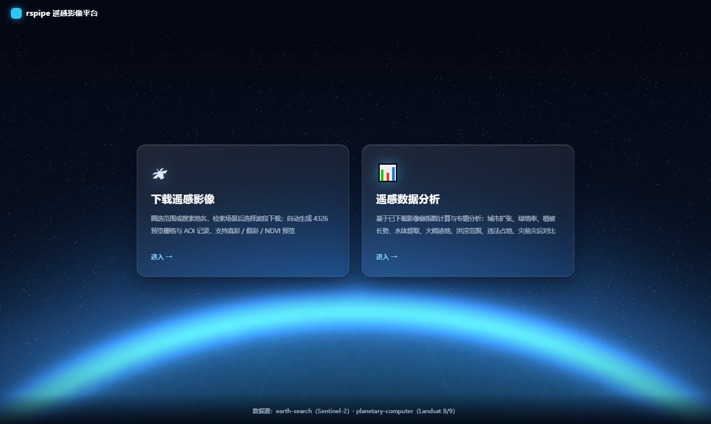
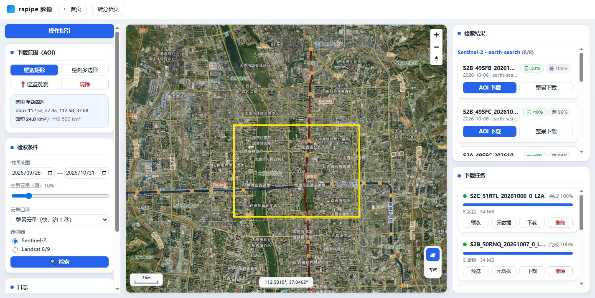
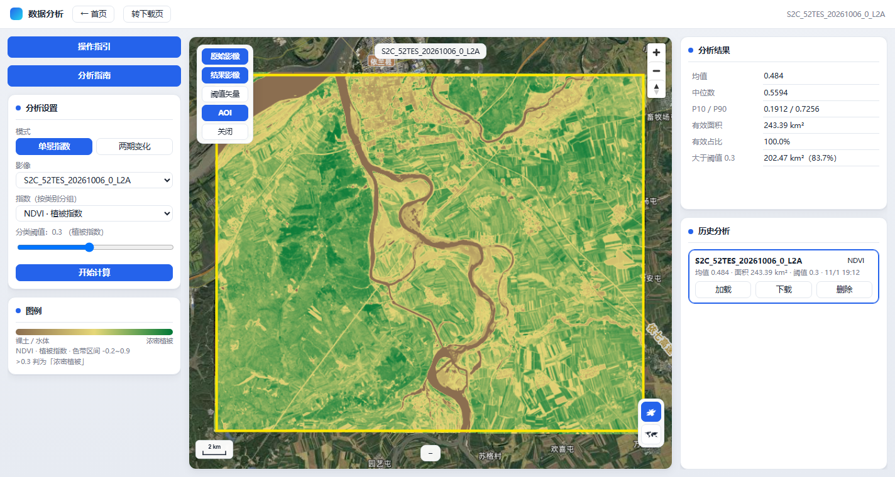
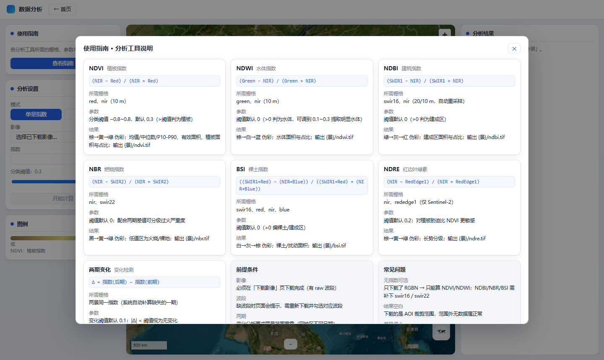
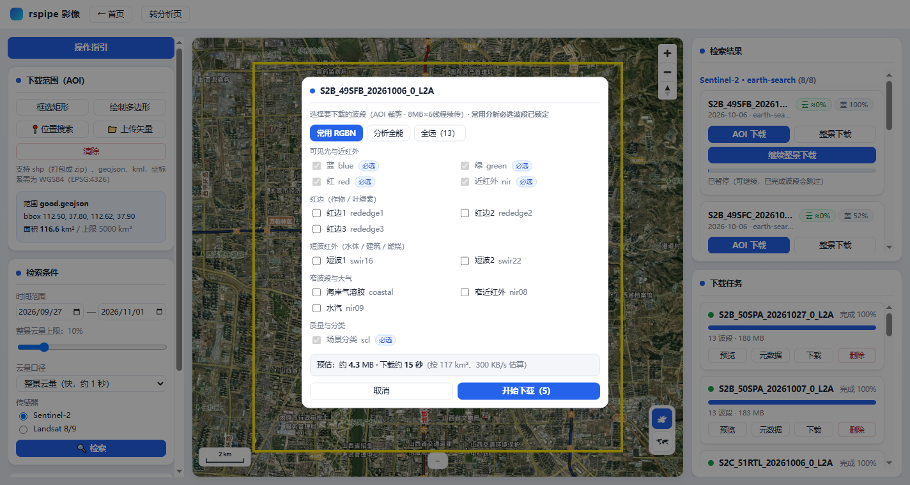
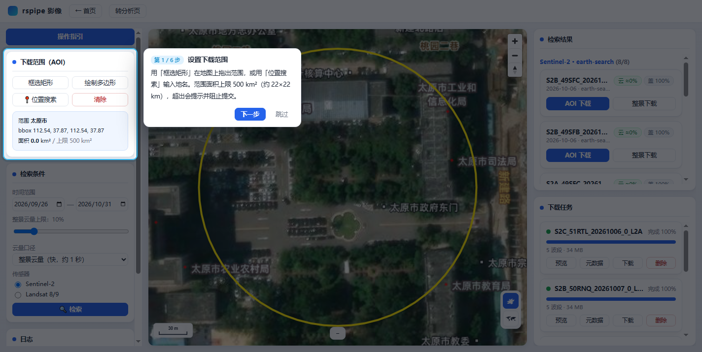
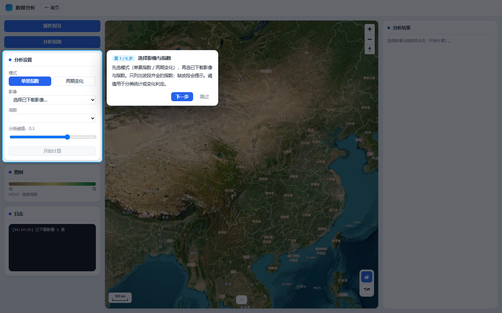

# rspipe — 遥感影像一站式平台（检索 · 下载 · 分析）

**输入一个地名，或在地图上圈一块地，几秒内看到 Sentinel-2 / Landsat 影像；
勾选需要的波段下载成可直接使用的数据产品；再在同一个网页里算植被指数、做两期变化对比。**

不需要注册账号，不需要云平台额度，不需要安装 ArcGIS/QGIS —— 数据源是公开的
[earth-search](https://earth-search.aws.element84.com/v1)（Sentinel-2 L2A）与
[Planetary Computer](https://planetarycomputer.microsoft.com/)（Landsat 8/9 L2），
后端只按 AOI 读取 COG 的瓦片窗口，**不下载整景**。

同时它也是一条完整的离线处理链：接入 → 归一化 → COG → 去云 → 匀色 → 镶嵌 → STAC → 检索/预览/下载，
可用命令行批量跑城市级数据。

## 下载安装（Windows，免环境）

**[⬇ rspipe-0.1.0-setup.exe](https://github.com/srmaper/rspipe/releases/download/v0.1.0/rspipe-0.1.0-setup.exe)** · 142 MB · 免 Python / Node / GDAL

双击安装即可，无需管理员权限；装到 `%LOCALAPPDATA%\Programs\rspipe`，
数据保存在 `%LOCALAPPDATA%\rspipe\data`（卸载不删数据）。
启动后浏览器自动打开 `http://127.0.0.1:8000`。

> 源码运行 / 二次开发见下文「快速开始」。

| 能力 | 模块 |
|---|---|
| 数据接入、归一化、COG 转换 | `clients` `ingest` `normalize` |
| 去云、匀色、无缝镶嵌、STAC | `process` `stac` |
| 定时增量更新 | `pipeline`（水位线 + cron） |
| 选景质量评估（AOI 实测云量 / Tier） | `quality.py` |
| Web 平台 | `src/rspipe/web/`（FastAPI 后端）+ `web/`（Vue3 前端） |

## 核心特性

| 模块 | 说明 |
|---|---|
| **AOI 圈选** | 矩形 / 多边形 / 地名搜索（geoscope，Nominatim 兜底），面积实时显示，上限 500 km² 防误操作 |
| **智能选景** | 不用整景云量，而是按 AOI 内实测云量 + 覆盖率 + Tier 排序，真正"看得见"的景排前面 |
| **波段级下载** | 按需勾选波段（10/20/60 m 各自分辨率），弹窗预估体积与耗时；断点续传、分块并发、失败重试 |
| **瓦片预览** | 后端按墨卡托几何求交渲染 256 瓦片，按景缓存 2%–98% 拉伸，拼接无花斑；真彩 / 假彩 / NDVI |
| **产品化输出** | 一键导出 zip：`preview_4326.tif` + `composite.tif`(uint16) + `aoi.geojson` + `quicklook.png` + `README.txt` + `raw/` + STAC json |
| **指数分析** | NDVI / NDWI / NDBI / NBR / BSI / NDRE，阈值分类与面积统计 |
| **变化检测** | 任选两期同一指数差值，输出变化面积（减少/增加），支持双屏滑动对比 |
| **任务中心** | 同景去重 + 每景锁 + sqlite 持久化，重启后中断任务可续传（已完成波段跳过） |
| **一键运行** | Windows 双击 `一键部署环境.bat` + `一键启动服务.bat` 即可，自带崩溃自动拉起 |

## 技术栈

| 层 | 选型 |
|---|---|
| 后端 | Python 3.11+ / FastAPI / rasterio / numpy / pydantic |
| 前端 | Vue 3 + Vite + MapLibre GL（自绘底图、比例尺、坐标条） |
| 数据 | STAC API 检索 · COG 窗口读取 · SQLite 索引 · uint16 GeoTIFF |
| 质量 | pytest（90 项，无需联网）+ ruff |

---

## 界面预览

| 首页 | 下载影像 |
|---|---|
|  |  |

| 遥感数据分析 | 使用指南 |
|---|---|
|  |  |

| 波段选择（含体积/耗时预估） |
|---|
|  |

| 操作指引（下载页） | 操作指引（分析页） |
|---|---|
|  |  |

---

## 快速开始

### 0. 一键脚本（Windows，推荐新手）

| 文件 | 作用 |
|---|---|
| `一键部署环境.bat` | 自动查找 Python 3.11+（找不到可一键 winget 安装）→ 装依赖 → 构建前端 |
| `一键启动服务.bat` | 杀旧实例 → 启动服务（崩溃自动拉起）→ 自动打开 http://127.0.0.1:8000 |

双击即可，无需命令行基础。

### 1. Web 平台（推荐）

```powershell
scripts\web_server.cmd   # 杀旧实例并启动，监听 8000（崩溃自动拉起）
```

浏览器打开 **http://127.0.0.1:8000**（用 `127.0.0.1` 而不是 `localhost`，见"已知问题"）。

页面流程：**圈矩形 / 画多边形 / 地名搜索** 设 AOI → **检索** → 卡片选波段 **下载** →
任务卡 **预览 / 元数据 / 下载 zip / 删除**。

页面路由：

| 路径 | 页面 |
|---|---|
| `#/` | 首页（下载影像 / 数据分析 两个入口） |
| `#/download` | 检索 · AOI 圈选 · 选波段下载 · 真彩/假彩/NDVI 预览 · 导出 zip |
| `#/analysis` | 指数分析（NDVI/NDWI/NDBI/NBR/BSI/NDRE）、两期变化、双屏对比 |

> 单次下载 AOI 面积上限 **500 km²**（约 22 km × 22 km），超限会在页面中央提示并阻止提交；
> 更大范围请分块下载后用 `rspipe mosaic` 镶嵌。

> 仓库不含 `data/`（下载与计算产物，运行时生成，见 `data/README.md`）。

### 2. CLI

```bash
rspipe search --cloud 20 --limit 10          # 检索（AOI 实测云量排序）
rspipe run --full                            # 单次增量：发现→处理→发布
rspipe mosaic --date 20261023                # 匀色 + 羽化镶嵌
rspipe status                                # 水位线 / 已处理景
rspipe schedule                              # 常驻定时更新
```

### 3. 城市批量下载脚本

```powershell
python scripts/download_taiyuan.py raw|processed|all
```

脚本内 `TARGETS`（provider/collection/scene_id）+ `AOI` 常量换成目标城市即可复用。

### 4. Python API

```python
from rspipe.config import load_pipeline_config, Settings
from rspipe.pipeline import Pipeline

cfg = load_pipeline_config("configs")
pipe = Pipeline.from_config(cfg, Settings())
scenes = pipe.discover(force_full=True)
result = pipe.process_scene(scenes[0])
```

---

## 安装

```bash
pip install -e ".[dev]"          # 开发（pytest / ruff / mypy）
pip install -e ".[m2m]"          # USGS M2M 客户端
pip install -e ".[s2cloudless]"  # ML 去云

cd web && npm install && npm run build   # 前端（构建产物由 FastAPI 托管）
```

Python ≥ 3.11；Windows 上 rasterio wheel 自带 GDAL。

## 凭证

复制 `.env.example` 为 `.env`：

| 数据源 | 检索 | 资产 | 需要 |
|---|---|---|---|
| `earth-search` | 公开 | 公开 | 无 |
| `planetary-computer` | 公开 | 公开（自动 SAS 签名） | 无 |
| `usgs-landsat` | 公开 | 需 EROS 账号 | `USGS_M2M_USERNAME` / `USGS_M2M_TOKEN` |
| `cdse-s2` | OAuth2 | OAuth2 | `CDSE_CLIENT_ID` / `CDSE_CLIENT_SECRET` |

缺凭证的数据源自动跳过并告警。

---

## Web API

| 方法 | 路径 | 说明 |
|---|---|---|
| POST | `/api/search` | bbox + 时间 + 云量 → 按 Tier/AOI 实测云量/覆盖度排序 |
| GET | `/api/scenes/{provider}/{id}` | 场景详情（含 `local_bands`、`raw_bounds`） |
| POST | `/api/jobs` | 建任务：`raw`（可选 `bands` 白名单）/ `processed` |
| GET | `/api/jobs` | 任务列表（sqlite 持久化，重启不丢） |
| DELETE | `/api/jobs/{id}` | 删除任务并清理该景本地产物 |
| GET | `/api/tiles/{id}/{z}/{x}/{y}.png` | 瓦片（本地 COG → 本地 raw → 204） |
| GET | `/api/export/{id}` | 打包 zip（COG + composite.tif + raw + quicklook + README + STAC json） |
| POST | `/api/geocode` | 地名 → 边界（geoscope 主源，Nominatim 兜底，点/线自动 100m 缓冲） |
| GET | `/api/analysis/scenes` | 已下载影像清单（含可用波段、范围） |
| POST | `/api/analysis/run` | 计算单景指数（ndvi/ndwi/ndbi/nbr/bsi/ndre）+ 阈值分类统计 |
| POST | `/api/analysis/change` | 两期指数差值 + 变化面积（减少/增加） |
| GET | `/api/analysis/tiles/{key}/{name}/{z}/{x}/{y}.png` | 指数/变化结果伪彩瓦片 |
| GET | `/api/aoi` | `configs/aoi_*.geojson` 预设列表 |

**瓦片渲染**：本地 processed COG 优先，其次本地 raw 波段；都没有返回 204（不回落云端）。
按"瓦片 ∩ 影像范围"求交贴到 256 画布，无值区透明；每通道 2%~98% 拉伸。

---

## 处理链

由 `ProductProfile` 推导，COG 转换与辐射定标是条件步骤：

| 源形态 | 步骤链 |
|---|---|
| Earth Search / PC COG（L2 SR） | `stack → harmonize → cog_convert → cloud_mask → stac_publish` |
| CDSE `.SAFE`（S2 L2A） | `unpack → stack → harmonize → reproject → cog_convert → cloud_mask → stac_publish` |
| USGS `.tar`（L1 DN） | `unpack → stack → radiometric_normalize → reproject → cog_convert → cloud_mask → stac_publish` |

定标：S2 `ρ = DN/10000`；Landsat `ρ = DN×2.75e-05 − 0.2`。

---

## 配置

```
configs/
  pipeline.yaml   AOI、时间窗、云量阈值、波段、cron、水位线回溯
  providers.yaml  数据源端点、认证、抓取模式（vsi / download / windowed）
  sensors.yaml    波段映射、QA/SCL 位定义、兜底定标
  aoi_*.geojson   城市 AOI
```

## 数据布局

```
data/
  raw/{provider}/{scene_id}/    原始波段裁剪（uint16 DN）
  staging/{scene_id}/           中间产物（stack / norm / mask）
  derived/cog/                  成品 COG（float32 RGBNIR 反射率，已去云）
  catalog/{collection}/         STAC item（含 rspi:* 质量字段）
  index/                        catalog.sqlite + web_jobs.sqlite
  web_export/                   zip 导出缓存
```

---

## 性能与缓存

| 项 | 做法 | 效果 |
|---|---|---|
| 检索缓存 | STAC 结果落 `data/index/search_cache.sqlite`，TTL 24 h | 同一 AOI 二次检索 **47.5 s → 0.1 s** |
| 云量缓存 | AOI 实测云量持久化，重启不丢 | 重复检索零网络；只实测预筛后的前 20 景 |
| 签名缓存 | SAS token 带过期时间复用，并发上限 4，429 按 `Retry-After` 退避 | 消除 Planetary Computer 限流风暴 |
| 下载并发 | 顺序读时预取 8 块，全局并发上限 32 | 单连接被限速 17 KB/s → 实测 100 KB/s+ |

可用环境变量微调：`RSPIPE_CACHE_TTL`（秒）、`RSPIPE_MAX_CONNECTIONS`、
`RSPIPE_PREFETCH_BLOCKS`、`RSPIPE_SIGN_CONCURRENCY`。

## 验证

```bash
ruff check src tests scripts
ruff format --check src tests scripts
mypy                       # src/rspipe，0 error
pytest tests -q            # 90 项，无需网络
```

覆盖：云掩膜位解码与缓冲、直方图匹配、羽化镶嵌、辐射定标、COG 合规、STAC 生成、
SQLite 空间检索、水位线增量、CogReader 窗口/金字塔读取、瓦片渲染、选景排序。

---

## 项目结构

```
src/rspipe/
  auth.py         OAuth2 / M2M token
  bands.py        波段名解析（通用名 ↔ 产品名 ↔ 资产 key）
  config.py       YAML + .env + pydantic
  models.py       SceneMeta / AssetRef / ProductProfile / StepResult
  quality.py      Tier 解析、AOI 实测云量（缓存+并行）、选景排序
  cli.py          typer 命令行
  clients/        stac / usgs_m2m / cdse_odata / factory
  ingest/         fetcher / downloader / unpack / rangefile / cogreader / signing / httpproxy
  normalize/      reflectance / harmonize / reproject / cog / profile / io
  process/        clouds / color / mosaic
  stac/           items / catalog / store
  pipeline/       steps / runner / state / scheduler
  storage/        layout
  web/            app / schemas / jobs / download / preview / tiles / export / cleanup
web/              Vue3 + Vite + MapLibre 前端（dist 由 FastAPI 托管）
scripts/          城市下载脚本 + web_server.cmd
docs/             设计与问题记录
```

## 文档

- `docs/产品与数据源说明.md` — 波段含义、DN→彩色原理、产品规格
- `docs/web项目设计.md` — Web 平台架构与分期
- `docs/应用能力介绍.md` — 能做哪些应用（城市/农业/林业/水环境/灾害/执法等）、方法、产出与能力边界
- `docs/开发问题与经验.md` — 踩坑清单与规避方法

## 许可证

[MIT](LICENSE)。影像数据版权归各数据源所有（Sentinel-2 属 ESA/Copernicus，Landsat 属 USGS/NASA），
使用与署名请遵循其开放许可。

## 联系

使用中遇到问题、有新的分析需求，欢迎微信联系：**18734242374**（首页右上角「联系作者」亦可查看）。
